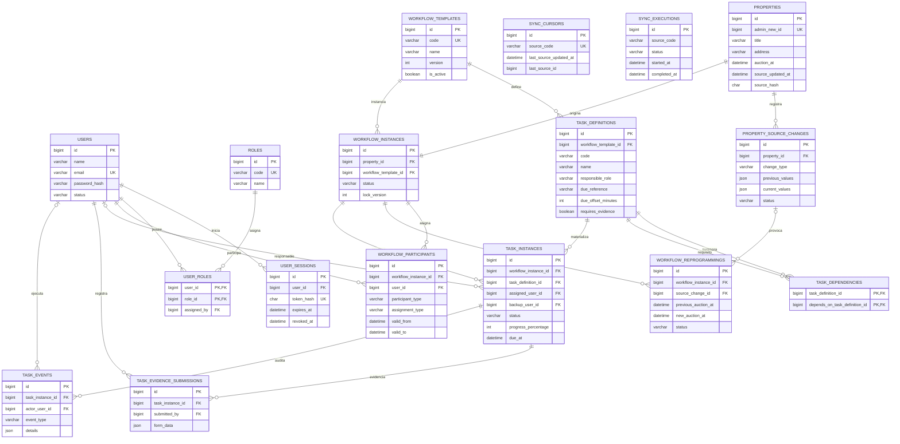

# Modelo de datos del MVP

## 1. Propósito

Este documento explica el modelo de datos reducido para el primer MVP del sistema de workflow de remates judiciales.

Está dirigido a desarrolladores y agentes de IA que necesiten comprender el alcance antes de proponer o implementar cambios.

Este modelo es más pequeño que el modelo completo disponible en [`sql/schema.sql`](../sql/schema.sql). No se debe asumir que todas las tablas del esquema completo forman parte del primer MVP.

## 2. Alcance funcional

El primer MVP debe permitir:

- Registrar usuarios.
- Iniciar y cerrar sesiones.
- Asignar uno o más roles a un usuario.
- Sincronizar propiedades aceptadas desde `admin_new`.
- Crear una instancia de workflow para cada propiedad aceptada.
- Asignar participantes principales y suplentes.
- Mostrar el dashboard de tareas del usuario.
- Abrir el detalle de una tarea en un modal.
- Registrar el avance de una tarea.
- Completar formularios de evidencia.
- Marcar una tarea como completada.
- Activar las tareas siguientes cuando se cumplan sus dependencias.
- Detectar cambios de fecha desde `admin_new`.
- Reprogramar el workflow y recalcular vencimientos abiertos.
- Conservar historial de cambios relevantes.

## 3. Fuera del alcance inicial

No forman parte del primer MVP, salvo que una decisión posterior los incorpore explícitamente:

- Redis u otro broker externo.
- Cola genérica de jobs.
- Transactional outbox.
- Notificaciones por correo.
- Documentos y archivos versionados.
- Editor visual de plantillas.
- Ramas posteriores al resultado del remate.
- Reportería avanzada.
- Permisos granulares por capacidad.
- Automatizaciones documentales completas.

La exclusión de una capacidad no autoriza a simularla silenciosamente dentro de otra tabla.

## 4. Principios del modelo

1. `admin_new` es una fuente externa de solo lectura.
2. La sincronización debe ser idempotente.
3. Un usuario puede tener varios roles.
4. Los participantes de un workflow pueden ser titulares o suplentes.
5. Las definiciones de tareas están separadas de las tareas reales.
6. El avance depende de relaciones entre tareas, no de un único número de paso.
7. Las transiciones deben ejecutarse dentro de transacciones.
8. Las tareas completadas conservan su historia y no se reescriben al reprogramar.
9. Los formularios JSON deben validarse según la tarea; no se acepta JSON arbitrario.
10. El estado `OVERDUE` no se almacena como estado de ejecución; se deriva desde `due_at`.

## 5. Diagrama relacional



## 6. Tablas del MVP

El modelo contiene 17 tablas agrupadas en cuatro áreas.

### 6.1 Autenticación y roles

#### `users`

Cuenta de una persona.

Campos principales:

- `id`: identificador interno.
- `name`: nombre visible.
- `email`: identificador único de acceso.
- `password_hash`: hash seguro; nunca contraseña en texto plano.
- `status`: `ACTIVE`, `INACTIVE` o `BLOCKED`.
- `created_at`, `updated_at`.

El registro de usuario no debe permitir que una persona se asigne libremente un rol privilegiado.

#### `user_sessions`

Sesiones revocables.

Campos principales:

- `user_id`.
- `token_hash`: solo se guarda el hash del token.
- `expires_at`.
- `revoked_at`.
- `created_at`.

El token real debe entregarse en una cookie segura y `HttpOnly` cuando se defina la estrategia de autenticación.

#### `roles`

Catálogo inicial:

- `ADMIN`.
- `MANAGER`.
- `BIDDER`.
- `LEGAL_REVIEWER`.

#### `user_roles`

Relación muchos a muchos entre usuarios y roles.

Clave primaria:

```text
(user_id, role_id)
```

También conserva cuándo y quién asignó el rol.

### 6.2 Integración con `admin_new`

#### `properties`

Copia operacional de los datos necesarios para ejecutar el workflow.

Campos relevantes:

- `admin_new_id`: identificador único del origen.
- Datos de ubicación y causa.
- `auction_at`.
- Fechas y monto de garantía.
- `source_updated_at`.
- `source_hash`.
- `last_synced_at`.

La restricción única sobre `admin_new_id` evita duplicados.

#### `sync_cursors`

Indica hasta qué punto fue revisado el sistema de origen.

Conserva:

- Fuente.
- Última fecha revisada.
- Último identificador revisado.
- Inicio y término de la última ejecución.
- Estado y error más reciente.

#### `sync_executions`

Historial operacional del sincronizador.

Estados:

- `RUNNING`.
- `SUCCEEDED`.
- `PARTIAL`.
- `FAILED`.

Registra filas leídas, creadas, actualizadas, advertencias y errores.

#### `property_source_changes`

Cambios relevantes detectados en el origen.

Tipos iniciales:

- `PROPERTY_ACCEPTED`.
- `AUCTION_DATE_CHANGED`.
- `PROPERTY_DATA_CHANGED`.
- `NO_LONGER_ACCEPTED`.

Conserva valores anteriores y nuevos para trazabilidad.

### 6.3 Definición y ejecución del workflow

#### `workflow_templates`

Plantilla versionada del flujo.

Restricción:

```text
UNIQUE (code, version)
```

Aunque el MVP tenga una sola plantilla, su versión debe conservarse.

#### `task_definitions`

Definición de cada tarea de la plantilla.

Campos importantes:

- Código y nombre.
- Descripción.
- Rol responsable.
- Orden visual.
- Si requiere evidencia.
- Referencia temporal.
- Desplazamiento del vencimiento en minutos.

Referencias temporales iniciales:

- `TASK_ACTIVATED_AT`.
- `AUCTION_AT`.
- `GUARANTEE_PAYMENT_AT`.
- `GUARANTEE_RETURN_AT`.
- `BALANCE_PAYMENT_AT`.

#### `task_dependencies`

Indica qué tareas deben completarse antes de activar otra.

Clave primaria:

```text
(task_definition_id, depends_on_task_definition_id)
```

No debe sustituirse por un único campo lineal de etapa.

#### `workflow_instances`

Ejecución real de una plantilla para una propiedad.

Estados iniciales:

- `ACTIVE`.
- `SUSPENDED`.
- `CANCELLED`.
- `COMPLETED`.

`lock_version` permite detectar actualizaciones concurrentes.

#### `workflow_participants`

Participantes titulares y suplentes de la instancia.

Tipos de participante iniciales:

- `MANAGER`.
- `BIDDER`.
- `LEGAL_REVIEWER`.

Tipos de asignación:

- `PRIMARY`.
- `BACKUP`.

Las asignaciones no se sobrescriben. Cuando cambian, se completa `valid_to` y se crea una nueva fila.

#### `workflow_reprogrammings`

Registro de cada reprogramación.

Conserva:

- Fecha anterior y nueva.
- Cambio del origen que la produjo.
- Origen de la acción.
- Motivo.
- Usuario solicitante, si aplica.
- Estado y error.

Estados:

- `PENDING`.
- `APPLIED`.
- `FAILED`.
- `CANCELLED`.

### 6.4 Operación de tareas

#### `task_instances`

Tareas reales mostradas en el dashboard.

Estados:

- `BLOCKED`.
- `READY`.
- `IN_PROGRESS`.
- `COMPLETED`.
- `CANCELLED`.

Campos importantes:

- Responsable y suplente.
- Porcentaje de avance.
- Fecha de vencimiento.
- Fecha de referencia usada para calcularla.
- Inicio y término.
- Usuario que completó.
- Versión de bloqueo optimista.

Una tarea vencida continúa en `READY` o `IN_PROGRESS`. Se considera vencida cuando:

```text
due_at < ahora
AND status IN ('READY', 'IN_PROGRESS')
```

#### `task_evidence_submissions`

Formulario de evidencia asociado a una tarea.

Campos:

- Tarea.
- Usuario que envió.
- Datos del formulario en JSON.
- Fechas de envío y actualización.

Para el MVP puede existir un formulario vigente por tarea:

```text
UNIQUE (task_instance_id)
```

El backend debe validar `form_data` según el código de la definición de la tarea.

#### `task_events`

Historial append-only de la tarea.

Eventos iniciales:

- `TASK_CREATED`.
- `TASK_ACTIVATED`.
- `TASK_ASSIGNED`.
- `TASK_REASSIGNED`.
- `TASK_STARTED`.
- `TASK_PROGRESS_UPDATED`.
- `EVIDENCE_SUBMITTED`.
- `TASK_COMPLETED`.
- `TASK_DUE_DATE_RECALCULATED`.
- `TASK_CANCELLED`.

## 7. Resolución de responsables y suplentes

La asignación inicial de una tarea debe resolverse en este orden:

1. Reasignación explícita de la tarea, si existe.
2. Participante principal vigente del tipo requerido.
3. Usuario activo con el rol requerido.
4. Administrador activo como fallback, si negocio lo aprueba.

El suplente se obtiene desde el participante `BACKUP` vigente correspondiente.

`task_instances.assigned_user_id` y `backup_user_id` conservan la asignación efectiva de esa tarea. Esto facilita el dashboard y evita que un cambio futuro altere tareas ya completadas.

## 8. Completar una tarea

Cuando el usuario marca una tarea como completada, el backend debe ejecutar en una sola transacción:

1. Autenticar al usuario.
2. Bloquear la tarea o instancia necesaria.
3. Verificar que el workflow siga activo.
4. Verificar que la tarea esté `READY` o `IN_PROGRESS`.
5. Verificar que el usuario tenga autorización.
6. Verificar evidencia obligatoria.
7. Cambiar la tarea a `COMPLETED`.
8. Registrar `completed_at` y `completed_by`.
9. Insertar `TASK_COMPLETED` en `task_events`.
10. Buscar tareas bloqueadas cuyas dependencias estén completas.
11. Cambiarlas a `READY`.
12. Registrar `TASK_ACTIVATED` por cada una.
13. Completar el workflow si no quedan tareas obligatorias abiertas.
14. Confirmar la transacción.

El frontend no debe modificar directamente estados, dependencias ni campos de finalización.

## 9. Registrar avance y evidencia

El porcentaje de avance debe estar entre 0 y 100.

Reglas sugeridas:

- `BLOCKED`: no admite avance.
- Primer avance mayor a cero: puede cambiar la tarea a `IN_PROGRESS`.
- Avance menor que 100: no completa la tarea.
- El check de completar ejecuta el caso de uso de finalización.
- Si se conserva `progress_percentage`, completar una tarea debe dejarlo en 100.
- Una tarea con evidencia obligatoria no puede completarse sin un formulario válido.

Si el MVP finalmente solo necesita check/no check, debe evaluarse eliminar `progress_percentage` para mantener el modelo más simple.

## 10. Sincronización

El sincronizador se ejecuta periódicamente en un proceso separado del servidor HTTP.

Para una propiedad nueva aceptada:

1. Consulta `admin_new` con credenciales de solo lectura.
2. Inserta o actualiza `properties` de forma idempotente.
3. Crea una sola instancia de workflow.
4. Materializa las tareas del flujo principal.
5. Activa las tareas sin dependencias pendientes.
6. Registra el resultado de la sincronización.

La restricción única sobre `admin_new_id` y la unicidad correspondiente de la instancia deben impedir duplicados aunque el proceso se ejecute más de una vez.

## 11. Reprogramación

Cuando cambia la fecha del remate:

1. El sincronizador registra `AUCTION_DATE_CHANGED`.
2. Crea una reprogramación `PENDING`.
3. Bloquea la instancia dentro de una transacción.
4. Actualiza `properties.auction_at`.
5. Recalcula `due_at` solo en tareas abiertas cuya referencia cambió.
6. Conserva intactas las tareas completadas.
7. Registra un evento por cada vencimiento modificado.
8. Marca la reprogramación como `APPLIED`.
9. Confirma la transacción.

La fecha no debe sobrescribirse silenciosamente sin conservar valor anterior, valor nuevo y origen del cambio.

## 12. Consultas del dashboard

El dashboard debe consultar tareas asignadas al usuario como titular o suplente.

Ejemplo conceptual:

```sql
SELECT
    task_instance.id,
    task_definition.name,
    task_definition.description,
    task_instance.status,
    task_instance.progress_percentage,
    task_instance.due_at,
    property.title AS property_title,
    property.address
FROM task_instances AS task_instance
JOIN task_definitions AS task_definition
  ON task_definition.id = task_instance.task_definition_id
JOIN workflow_instances AS workflow_instance
  ON workflow_instance.id = task_instance.workflow_instance_id
JOIN properties AS property
  ON property.id = workflow_instance.property_id
WHERE (
    task_instance.assigned_user_id = :user_id
    OR task_instance.backup_user_id = :user_id
  )
  AND task_instance.status IN ('READY', 'IN_PROGRESS')
  AND workflow_instance.status = 'ACTIVE'
ORDER BY
  task_instance.due_at IS NULL,
  task_instance.due_at,
  task_instance.id;
```

El SQL definitivo depende de la librería de acceso a datos aprobada y no debe copiarse sin revisar índices y autorización.

## 13. Decisiones todavía pendientes

Este documento no resuelve:

- Estrategia definitiva de autenticación y sesiones.
- Librería de validación.
- ORM, query builder o SQL directo.
- Frecuencia del sincronizador.
- Plazos exactos de cada tarea.
- Efecto de la suspensión sobre vencimientos.
- Si el administrador puede completar cualquier tarea.
- Si un suplente puede actuar simultáneamente o solo ante ausencia.
- Estructura exacta de cada formulario de evidencia.
- Criterio definitivo para filas duplicadas en `admin_new`.

Un agente no debe tomar estas decisiones silenciosamente. Debe presentar alternativas y solicitar aprobación antes de incorporarlas al código o al esquema definitivo.

